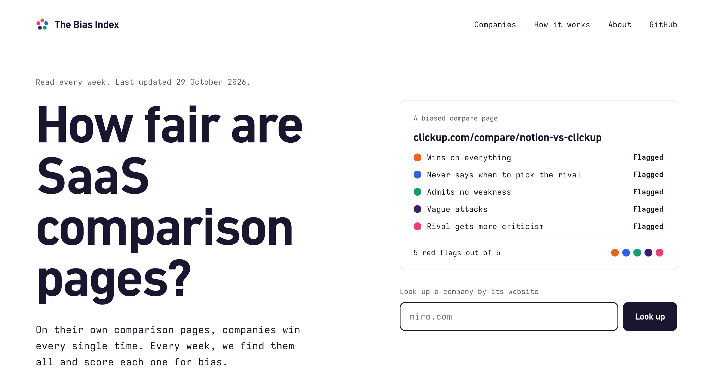
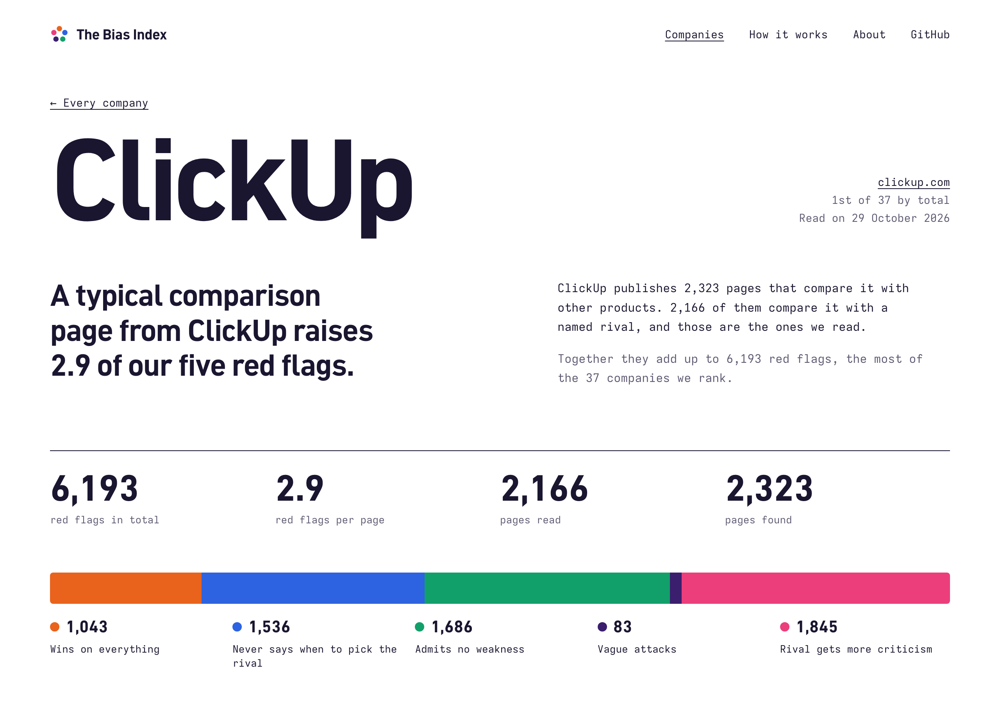
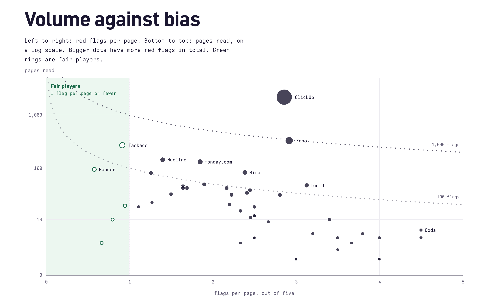

<a href="https://thebiasindex.com"></a>

# thebiasindex.com

Vendors write pages about their rivals ("X vs Y", "X alternatives"), and AI assistants repeat them as if they were
genuine reviews. thebiasindex.com finds every one of those pages in a company's sitemap, asks five yes/no questions
about it, and lights a lamp for each yes. Every week, in the open.

Built by [Whimsical](https://whimsical.com), scored like everyone else. Why: [The anatomy of a SaaS comparison
page](https://whimsical.com/blog/the-anatomy-of-a-saas-comparison-page).

## Five lamps, five questions

A comparison page on a vendor's site is going to argue the vendor is better at something. That's its job, and it
isn't what we score. We score whether it's honest about the rest. Each yes is a red flag; a page lights 0 to 5.

| | Lamp | Lit when the page… |
|---|---|---|
| Q1 | **Best at everything** | concedes nothing where the competitor is stronger |
| Q2 | **No honest exit** | never says who should pick the competitor |
| Q3 | **No admitted weakness** | can't be quoted admitting a single thing the vendor's product can't do |
| Q4 | **Vague attacks** | criticizes competitors with nothing checkable: no specifics, numbers or sources |
| Q5 | **Uneven scrutiny** | gives the competitor clearly more criticism than the vendor |

A page that scores 0 is still a sales page. It just isn't a misleading one: it says what the rival does better,
tells some readers to pick it, admits one thing it can't do, and criticizes with facts.

## Every company, every page



Companies are ranked by total red flags across their competitor comparisons, so volume counts as well as bias. Fair
players (1 red flag per page or fewer, across at least 3 pages) aren't ranked; they're proof it can be done.



## Look a company up by its domain

| | |
|---|---|
| `thebiasindex.com/<domain>` | The company page, e.g. [`/clickup.com`](https://thebiasindex.com/clickup.com) |
| `thebiasindex.com/<domain>.json` | The same numbers as data, with every scored page and its five answers |
| `thebiasindex.com/companies.json` | Every company |
| `thebiasindex.com/llms.txt` | What the index is and how to read it, for assistants |

## How reliable is it

Scores come from OpenAI's `gpt-6-luna` classifier. Before a methodology version scores anything, it's tested on
labeled pages, and the headline numbers come from 164 pages from 34 companies it was never tuned on. Labels were
written by one model and cross-checked by two others. Three checks miss their target, and we say so.

- [`docs/METHODOLOGY.md`](docs/METHODOLOGY.md): which pages are checked, the scoring rules, the agreement table
- [`docs/RESULTS.md`](docs/RESULTS.md): every benchmark run, including the versions that failed
- [`docs/LABELING_GUIDELINES.md`](docs/LABELING_GUIDELINES.md): the rules used to label pages
- [`benchmark/`](benchmark/): every label, every panel vote, every model output
- [`docs/ROADMAP.md`](docs/ROADMAP.md): what's next

Reproduce the published table without any API key: `uv run pipeline/consolidated.py`.

## Open data

Every weekly run is published as a [release](https://github.com/WhimsicalCode/thebiasindex.com/releases/latest): the SQLite database the site is built from, plus
`companies.csv` (one row per company) and `pages.csv` (every candidate page, with the five answers of each compare
page as red-flag probabilities). The latest is always at

```
https://github.com/WhimsicalCode/thebiasindex.com/releases/latest/download/bias_index.sqlite
https://github.com/WhimsicalCode/thebiasindex.com/releases/latest/download/companies.csv
https://github.com/WhimsicalCode/thebiasindex.com/releases/latest/download/pages.csv
```

Older weeks stay available: the last 8 weekly releases, then one per month.

## Run it yourself

The pipeline needs [uv](https://docs.astral.sh/uv/) and an OpenAI API key; the site needs Node 22.

```bash
curl -L --create-dirs -o data/bias_index.sqlite https://github.com/WhimsicalCode/thebiasindex.com/releases/latest/download/bias_index.sqlite

export OPENAI_API_KEY=...
uv run pipeline/run.py           # discover, fetch, score, starting from the latest data

cd web && npm install
npm run dev                      # http://localhost:4321
npm run build                    # static site in web/out
```

Every candidate page is fetched each week; a page is scored again only when its text or the methodology changes.
`--max-pages-per-company 20` gives a quick local sample. The site only needs the database, not an API key: it reads
it at build time (Astro, static).

| Script | What |
|---|---|
| `discover.py` | Candidate comparison URLs from sitemaps |
| `fetch_pages.py` | Polite fetching (robots.txt, 1 request per second per site) and text extraction |
| `classify.py` | Luna scoring (methodology v8) |
| `evaluate.py`, `consolidated.py` | Agreement with labeled pages, per set and pooled |
| `ai_review.py`, `review_app.py` | The two-model review panel and a review app (`uv sync --group review`) |
| `select_benchmark.py` | Draw benchmark samples |
| `export.py`, `prune_releases.py` | CSV exports for the weekly release, and thinning out old releases |

Benchmark page text isn't committed, because it's the vendors' content. Re-fetch a set with
`uv run pipeline/fetch_pages.py benchmark/<set>/pages.csv data/raw/<set>`.

Want a company added? Open an issue or a pull request adding it to [`pipeline/domains.yml`](pipeline/domains.yml).

## License

MIT, see [`LICENSE`](LICENSE). That covers the code, the methodology, the benchmark labels and the data.
